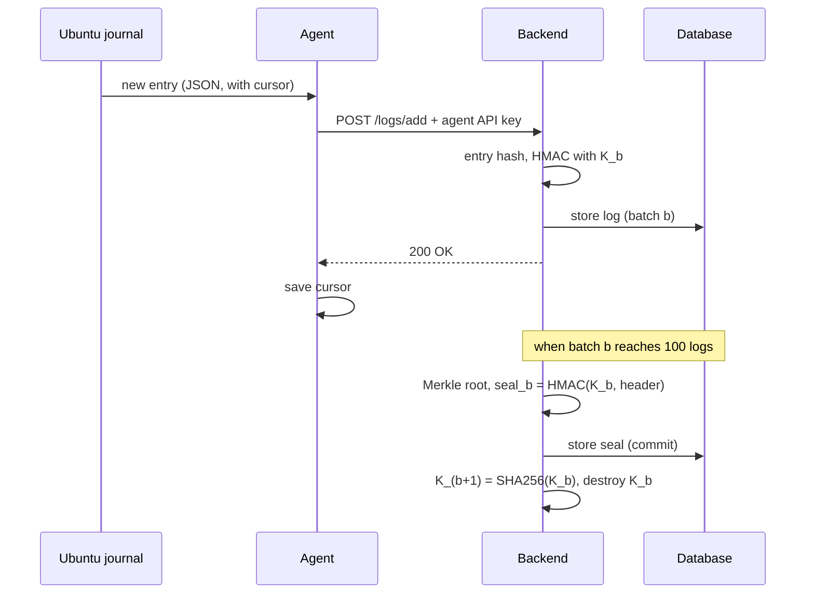

# SecureLog: Security Design and Threat Model

## 1. Goal

Logs are the main evidence after a security incident, so they are the first
thing an attacker tries to delete or change. SecureLog's goal is **tamper
evidence**: it cannot stop someone with full access from changing the stored
data, but any change, deletion, insertion or reordering must be **detected**,
and a key stolen today must not allow forging the past.

## 2. Threat model

| Adversary | Capabilities | Must be detected? |
|---|---|---|
| Attacker on the Ubuntu server | root access, can delete local logs, stop services | Logs already sent must survive and remain trustworthy |
| Database attacker / insider | read and write the SQLite file, no secret key | Any change to stored logs or seals |
| Smart database attacker | as above, and recomputes every public hash and Merkle root | Yes, through HMACs and seals |
| Server compromise at time T | everything above **plus** the current secret key | Any change to logs sealed **before** T (forward security) |
| Network / web attacker | calls the API, guesses passwords | No unauthorized access or log injection |

**Trusted:** the offline auditor key K0, the auditor machine, and the backend
before compromise.

## 3. Data flow



## 4. Cryptographic construction

All primitives are in `backend/services/crypto_core.py` and are re-implemented
independently in the offline auditor `auditor_verify.py`, which is kept
with K0 on the auditor's machine, not in this repository.

```
entry_hash_i = SHA256("SLv1-entry" ‖ canonical(log_i) ‖ entry_hash_(i-1))
mac_i        = HMAC-SHA256(K_b, "SLv1-mac" ‖ entry_hash_i)        b = batch of log i
root_b       = Merkle(entry hashes of batch b)
                 leaf = SHA256(0x00 ‖ h), node = SHA256(0x01 ‖ left ‖ right)
seal_b       = HMAC-SHA256(K_b, "SLv1-seal" ‖ canonical{batch_id, first/last log id,
                    count, root_b, seal_(b-1), key_version})
K_(b+1)      = SHA256("SLv1-evolve" ‖ K_b)          K_b is then overwritten
```

- `canonical(log)` covers id, received time, original event time, source,
  event type, user, IP, message and **agent_id**, so none of them can change
  undetected. The id binds each log to its position.
- **Domain separation** (`SLv1-...` prefixes and the 0x00/0x01 Merkle prefixes)
  prevents one kind of hash from being passed off as another, and avoids the
  duplicate-leaf ambiguity of CVE-2012-2459.
- **Seal chain**: each seal includes the previous seal, so deleting or
  reordering whole batches breaks the chain.

## 5. Forward security

The server only ever holds the key of the **open** batch. Sealing batch b
uses K_b, then the key is evolved one-way and K_b is overwritten. Because
SHA-256 cannot be inverted, an attacker who steals K_v cannot compute any
earlier key, so they cannot produce valid MACs or seals for batches before v.
The auditor starts from K0 and derives every key to verify everything.

**Crash safety:** the seal is committed to the database **before** the key is
evolved. If the server crashes between the two steps, the next request
evolves the key automatically; the reverse order could destroy a key before
its batch was sealed.

## 6. Who verifies what

| Check | Server (every 30 s) | Auditor with K0 |
|---|---|---|
| Hash chain links and content hashes | ✅ | ✅ |
| Merkle roots, batch ranges, numbering | ✅ | ✅ |
| Seal chain links | ✅ | ✅ |
| HMACs of the open batch | ✅ | ✅ |
| HMACs and seals of sealed batches | ❌ keys destroyed | ✅ |
| Key version vs. sealed batches | ✅ | - |

The monitor runs while no log is being written, so it never sees half of a
seal (a race that otherwise produced false alarms under load). When the status
changes to Tampered it stores an alert and writes an `INTEGRITY_ALERT` event
into the ledger itself.

## 7. API security

| Mechanism | Detail |
|---|---|
| Agent authentication | one random 256-bit key per agent; the server stores only SHA-256(key) |
| Source identity | `agent_id` is set by the server from the authenticated key, never from the request, and is hashed |
| Admin password | PBKDF2-HMAC-SHA256, 600,000 iterations, random salt |
| Session tokens | HS256-signed, 8-hour expiry, `alg` must be HS256, revoked on logout |
| Login lockout | 5 failures per IP, then 15 minutes; constant-time checks |
| Browser access | CORS limited to the dashboard origin; security headers |
| Accountability | logins, failed logins, logouts, manual seals and demo attacks are logged in the ledger |
| Demo attacks | only when `SECURELOG_DEMO_MODE=true` |
| Secrets | in `backend/.env` (permission 600, not in git) |

## 8. Agent reliability and least privilege

- Reads the journal as JSON; uses the original event time and real fields.
- **Spool**: failed sends are written to disk (fsync) and delivered in order;
  new logs queue behind old ones, so order is preserved.
- **Cursor**: saved only after a log is sent or safely queued, so a restart or
  reboot resumes exactly where it stopped.
- Ignores its own output (prevents a logging loop).
- Runs as a dedicated `securelog-agent` user in the `systemd-journal` group,
  with systemd hardening (`ProtectSystem=strict`, `NoNewPrivileges`, ...).
  Its config is readable only by root and that user.

## 9. Evaluation summary

Attack detection (see `TEST_REPORT.md`): **12 of 14** simulated database
attacks are detected. The server detects 10; the 2 it misses (a full rewrite
of already-sealed data, and a rewrite of old batches with a stolen current
key) are caught by the auditor, which demonstrates the forward-security
property. The remaining 2 are the documented limitations below.

Live tests on the Ubuntu server: SSH brute force, sudo abuse of
`/etc/shadow`, creation of a backdoor sudo account, firewall port probes,
and the attacker wiping the server's journal were all recorded. After the
wipe, every earlier event was still on the log server and verified as Valid,
and the wipe command itself was recorded.

Performance: see `benchmark_results.md`.

## 10. Limitations and future work

1. **Open batch:** an attacker holding the current key can rewrite or truncate
   logs that are not yet sealed. Mitigation: smaller batches or time-based sealing.
2. **Tail truncation:** deleting the newest unsealed logs needs an external
   anchor to detect (for example, publishing each seal to a second server).
3. **Agent silence:** if an attacker stops the agent, the backend does not yet
   raise an alert. Future work: agent heartbeats with a missing-heartbeat alert.
4. **Transport:** agent traffic is plain HTTP inside the virtual network; a
   production deployment should use HTTPS.
5. **Key erasure:** overwriting a file does not guarantee the old key is
   physically erased from disk or memory; production systems use a TPM/HSM.
6. **K0 power:** whoever holds K0 can verify and also forge; it must stay offline.
7. **Single writer:** one backend process; revoked tokens and login lockouts
   reset on restart; one admin account without roles.
8. **Write throughput** is limited by saving every log durably before
   acknowledging it; batching writes is future work.

## 11. References

1. B. Schneier and J. Kelsey, "Secure Audit Logs to Support Computer Forensics,"
   *ACM Transactions on Information and System Security*, 1999.
2. M. Bellare and B. Yee, "Forward-Security in Private-Key Cryptography," CT-RSA 2003.
3. R. Merkle, "A Digital Signature Based on a Conventional Encryption Function," CRYPTO 1987.
4. S. Crosby and D. Wallach, "Efficient Data Structures for Tamper-Evident Logging,"
   USENIX Security 2009.
5. CVE-2012-2459, Merkle tree duplicate-leaf ambiguity (Bitcoin).
6. OWASP Password Storage Cheat Sheet (PBKDF2 iteration guidance).