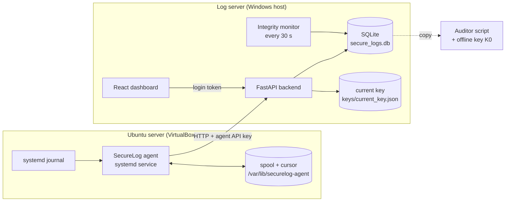

# SecureLog: Tamper-Evident Log Management System

Final Year Project, BS Cybersecurity.

SecureLog collects security logs from Ubuntu servers and stores them so that
**any change, deletion, insertion or reordering is detected**, even by an
attacker who has full access to the database. It combines a SHA-256 hash
chain, Merkle trees, and forward-secure HMAC keys, and adds a live dashboard,
automatic integrity monitoring and an independent auditor.

## Features

- **Ubuntu agent**: reads the systemd journal in real time, extracts the real
  user, IP, program and original event time, and classifies events
  (brute force, sudo abuse, account changes, firewall blocks...).
- **No lost logs**: if the backend is down, the agent queues logs on disk and
  delivers them in order later; after a reboot it resumes where it stopped.
- **Tamper evidence**: every log is hash-chained and HMAC-tagged; every 100 logs
  are sealed with a Merkle root and a forward-secure HMAC seal.
- **Forward security**: the signing key evolves one-way after every batch and
  the old key is destroyed, so stealing the server's key today cannot be used
  to forge yesterday's logs.
- **Integrity monitor**: re-verifies the whole log every 30 seconds and raises
  an alert the moment tampering appears.
- **Independent auditor**: a standalone script that verifies everything,
  including the seals, from the offline key K0.
- **Secure API**: per-agent API keys, password login with lockout, signed
  session tokens, restricted CORS, and every login/admin action recorded in
  the tamper-evident log itself.
- **Dashboard**: severity statistics, threat feed, search across all logs,
  Merkle batch list, Merkle inclusion proofs, integrity alerts.

## Architecture



## Project structure

```
secure_log/
├── agents/
│   ├── ubuntu_log_agent.py        the agent (Python standard library only)
│   ├── securelog-agent.service    systemd unit (runs as a low-privilege user)
│   ├── install.sh                 installs the agent as a service
│   ├── agent.conf.example         agent configuration template
│   └── test_agent.py              agent tests (run on Linux)
├── backend/
│   ├── main.py                    FastAPI app, startup checks, CORS, monitor
│   ├── manage.py                  setup: .env, admin password, agent keys
│   ├── config.py                  settings from backend/.env
│   ├── models.py, schemas.py      database tables and request formats
│   ├── security.py                API key / login checks
│   ├── routes/                    auth, logs, verify, merkle, dashboard, keys
│   ├── services/
│   │   ├── crypto_core.py         all hashing, HMAC, sealing, key evolution
│   │   ├── merkle_service.py      Merkle trees and inclusion proofs
│   │   ├── key_manager.py         forward-secure key storage
│   │   ├── ledger.py              append, seal, verify, demo attacks
│   │   ├── monitor.py             background integrity monitor and alerts
│   │   ├── auth.py                passwords, tokens, agent keys, lockout
│   │   ├── severity.py            severity rule
│   │   └── dashboard_service.py   dashboard statistics
│   └── tests/                     backend test suites
├── frontend/                      React + Vite dashboard
└── scripts/
    ├── auditor_verify.py          independent auditor (standard library only)
    ├── generate_1000_logs.py      test data generator
    ├── attack_lab.py              attack detection matrix
    ├── benchmark.py               performance measurements
    └── run_all_tests.py           runs everything, writes TEST_REPORT.md
```

## Requirements

| Machine | Needs |
|---|---|
| Log server (Windows) | Python 3.11 or 3.12, Node.js 22 LTS |
| Ubuntu server | Ubuntu with systemd and Python 3 (preinstalled) |
| Network | The Ubuntu machine must reach the backend on port 8000 |

## Setup (first time)

### 1. Backend

```powershell
cd secure_log\backend
py -3.11 -m venv venv
.\venv\Scripts\Activate.ps1
pip install -r requirements.txt
python manage.py init
uvicorn main:app --host 0.0.0.0 --port 8000 --reload
```

`manage.py init` asks for the dashboard username and password and prints the
first **agent API key once**; copy it. On first start the backend prints the
location of `keys\AUDITOR_K0.key`: **move that file off the server**
(USB / auditor machine). Whoever holds K0 can verify, and forge, every log.

### 2. Frontend

```powershell
cd secure_log\frontend
npm install
npm run dev
```

Open http://localhost:5173 and log in.

### 3. Ubuntu agent

Copy `agents/ubuntu_log_agent.py`, `securelog-agent.service` and `install.sh`
to the Ubuntu server, then create `agent.conf` next to them:

```ini
[agent]
api_url = http://10.0.2.2:8000/logs/add
api_key = <agent key from manage.py>
```

Backend address as seen from the VM: **10.0.2.2** with VirtualBox NAT,
**192.168.56.1** with a host-only adapter (needs a Windows Firewall rule for
port 8000).

```bash
sed -i 's/\r$//' install.sh securelog-agent.service ubuntu_log_agent.py agent.conf
sudo bash install.sh
```

The agent now runs as the `securelog-agent` service and starts at every boot.

## Daily use

1. Start the backend (`uvicorn main:app --host 0.0.0.0 --port 8000 --reload`).
2. Start the frontend (`npm run dev`).
3. Start the Ubuntu VM. The agent starts by itself.

| On Ubuntu | Purpose |
|---|---|
| `sudo systemctl status securelog-agent` | is the agent running? |
| `sudo journalctl -u securelog-agent -f` | watch what it sends |
| `sudo systemctl restart securelog-agent` | apply config changes |

## Administration

| Command (backend folder) | Purpose |
|---|---|
| `python manage.py add-agent NAME` | key for a new server (`--force` replaces it) |
| `python manage.py remove-agent NAME` | revoke a server's key |
| `python manage.py list-agents` | list registered agents |
| `python manage.py set-password` | change the dashboard password |

Restart the backend after any change. **Fresh start:** stop the backend and
delete both `secure_logs.db` and the `keys` folder (never only one of them).

## Verification and auditing

- **Dashboard**: integrity is checked automatically every 30 seconds;
  *Verify Hash Chain* checks immediately.
- **Auditor** (on a separate machine, with a copy of the database):

```powershell
python scripts\auditor_verify.py --db secure_logs_copy.db --k0 AUDITOR_K0.key
```

The auditor is the only party that can verify the seals of old batches,
because the server destroyed those keys.

## Tests and evaluation

```powershell
python scripts\run_all_tests.py                 # all suites + attack matrix -> TEST_REPORT.md
cd backend
python ..\scripts\benchmark.py --out ..\benchmark_results.md
```

On Ubuntu: `python3 test_agent.py` in the agent folder.

## Troubleshooting

| Symptom | Fix |
|---|---|
| Backend: "Security settings are missing" | run `python manage.py init` |
| Backend: "created by an older version" | delete `secure_logs.db` and `keys` |
| 409 "Key is at version X but ... open batch is Y" | database and key folder don't match; restore both together or delete both |
| Agent: `401 ... rejected the API key` | wrong key in `/etc/securelog-agent/agent.conf` |
| Agent: `backend unreachable` | backend stopped or wrong address; logs are queued, not lost |
| Dashboard blank | press F12 → Console and read the error |
| `npm` not recognized | install Node.js, then open a new terminal |

See **SECURITY_DESIGN.md** for the cryptographic design, threat model and limitations.